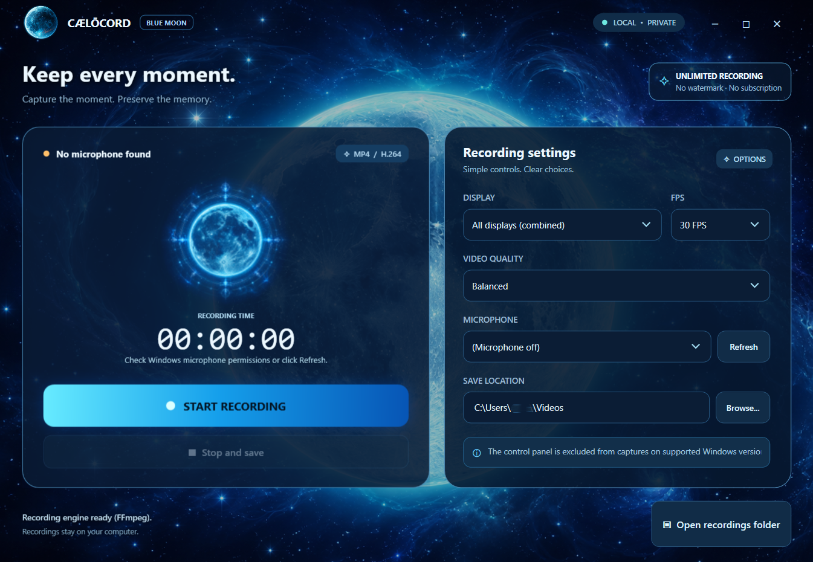

<div align="center">


# CÆLŌCORD
### Blue Moon Edition

**Keep every moment. Capture the moment. Preserve the memory.**

<p>
  
  
  
  
  
</p>

A Windows screen recording app with a **cosmic Blue Moon visual identity**, a clean single-window workflow, and a lightweight release path for GitHub distribution.

</div>

---

## ✨ Showcase

<p align="center">
  
</p>

<div align="center">

> **Elegant. Focused. Local.**  
> No watermark. No subscription. No forced cloud workflow.

</div>

---

## 🌙 Highlights

- **Single-window recording workflow**
- **MP4 / H.264** screen capture
- **15 / 30 / 60 FPS** options
- **Optional microphone recording**
- **Blue Moon themed interface**
- **Animated lunar recording emblem** during active capture
- **Control panel exclusion** on supported Windows versions
- **Portable-friendly behavior**
- **FFmpeg auto-detection** and optional first-run download
- **GitHub-ready structure** with source + release separation

---

## 🚀 Quick Start

### Option A — Use the ready release
1. Open the `Release` folder.
2. Run **`Cælōcord.exe`**.
3. Choose display, FPS, quality, microphone, and save location.
4. Click **Start Recording**.
5. Click **Stop and save** when finished.

### Option B — Run from source
1. Open the `Source-Code` folder.
2. Double-click **`run-from-source.bat`**.
3. The PowerShell interface will launch.

---

## 🧩 Repository Layout

```text
Caelocord/
├─ README.md
├─ LICENSE
├─ THIRD_PARTY_NOTICES.md
├─ assets/
│  └─ caelocord-preview.png
├─ Release/
│  ├─ Cælōcord.exe
│  ├─ RELEASE_NOTES.txt
│  └─ SHA256SUMS.txt
├─ Source-Code/
│  ├─ run-from-source.bat
│  ├─ launcher/
│  │  ├─ main.go
│  │  ├─ build-windows.ps1
│  │  ├─ ffmpeg_download.go
│  │  ├─ ffmpeg_embedded.go
│  │  ├─ Cælōcord.ico
│  │  ├─ icon_windows_amd64.syso
│  │  └─ payload/
│  │     ├─ Caelocord.ps1
│  │     └─ art/
│  └─ tools/
└─ .github/
   └─ workflows/
      └─ windows-release.yml
```

---

## 🎥 Recording Features

| Feature | Status |
|---|---|
| Full-screen / multi-display capture | ✅ |
| MP4 output | ✅ |
| Microphone input | ✅ |
| Control panel hidden from capture* | ✅ |
| Time limit | ❌ None |
| Watermark | ❌ None |
| Subscription | ❌ None |
| System audio capture | ⚠️ Not included in this build |

> \* Works on supported Windows versions and compatible capture methods.

---

## 🛠️ Build Notes

The repository includes a **Go-based launcher** and the **PowerShell/WPF UI payload**.

- The release EXE bundles the app launcher and visual assets.
- FFmpeg is **reused if already installed** or can be downloaded on first use with user consent.
- The GitHub workflow is intended to help automate Windows release builds.

---

## 🔒 Privacy

Cælōcord is designed to keep recordings **local on the user’s computer**.

- No cloud upload workflow is built in
- No account system is required
- No watermark is applied to exported recordings

---

## 📦 Third-Party Notes

This project relies on **FFmpeg** for recording functionality.
Please review **`THIRD_PARTY_NOTICES.md`** and FFmpeg licensing requirements before wide redistribution.

---

## 🧪 Status

This package was prepared for GitHub publishing and project showcasing.  
Please still perform a **real Windows test pass** before public release.

---

## 📜 License

This repository is distributed under the **MIT License** unless otherwise noted.  
See **`LICENSE`** for details.

---

<div align="center">

### CÆLŌCORD · BLUE MOON EDITION
**Capture · Preserve · Remember**

</div>
